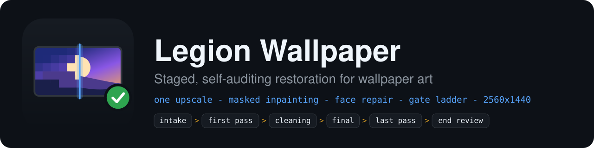
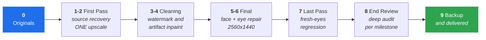

<div align="center">



# Legion Wallpaper

**A staged, self-auditing image restoration pipeline, and the Claude Code agent system that builds it.**

[](https://github.com/Remus3/Legion-Wallpaper/actions/workflows/ci.yml)
[](https://github.com/Remus3/Legion-Wallpaper/actions/workflows/codeql.yml)
[](LICENSE)
[](https://www.python.org/)
[](#development-and-tests)

</div>

Drop an illustration into `images\0.Originals`. The pipeline finds the best
full-resolution source and upscales it exactly once. It removes watermarks and
artifacts by masked LaMa inpainting, repairs faces and eyes, and delivers an
approved 2560x1440 PNG. Every stage audits its own output through a gate ladder
of metrics and a vision reviewer. Nothing advances on an unbacked claim: an
agent never approves its own output.

## The images are not here

They never will be. The wallpapers are third-party illustrations, `images/**`
is gitignored, and the restored output stays private. This repo publishes the
pipeline code, the gate ladder, the provenance manifests and the agent operating
system that produced them.

## Quick start

Try the code without the corpus or the GPU stack:

```powershell
git clone https://github.com/Remus3/Legion-Wallpaper.git
cd Legion-Wallpaper
python -m pip install -r requirements.txt
python tools\install_git_hooks.py           # arm the commit gates
python tools\lw_suite.py -q                   # GPU-only tests skip
```

`requirements.txt` is hash-pinned and compiled from `requirements.in`. The
super-resolution, inpainting and face-repair stacks (torch, spandrel, LaMa,
IOPaint, ComfyUI) live in virtualenvs outside the repo. Built around one
machine, one corpus and one operator: treat it as a reference implementation,
not a turnkey tool.

## Usage

On a provisioned machine, `tools\lw_pipeline.py` is the single writer. It moves
images between stages; nothing is dragged by hand.

```powershell
python tools\lw_pipeline.py scan           # refresh pipeline_state.json
python tools\lw_pipeline.py status         # per-stage counts and needs-attention list
python tools\lw_pipeline.py intake --all   # pull new files out of 0.Originals
python tools\lw_pipeline.py approve <slug> # operator approval of a submission
```

Each stage also has a Claude Code slash command under `.claude/commands/`
(`/intake`, `/first-pass`, `/cleaning-pass`, `/final-pass`, `/last-pass`,
`/end-review`).

## Architecture and layout



Ten numbered stage folders under `images\`, each a scratch/done pair, with an
append-only transition log and an atomic state file. Every advance is gated:

| Gate | Asks |
|---|---|
| **G0** intake | Is this file real, stable, and worth a slot? |
| **G1** fidelity | Full-reference metrics (MS-SSIM, LPIPS, DISTS) at a common scale, plus sharpness and halo checks |
| **G2** style | Does the result still look like the corpus it came from? |
| **Vision** | A Claude reviewer that may FLAG but never REJECT ([ADR-008](docs/adr/ADR-008-vision-reviewer-flags-never-rejects.md)) |

A rejection demotes the image to the previous stage with the reason logged, or
routes it to a human QA queue. Autonomy is earned through a calibration ladder:
shadow, then spot-check, then full auto, each promotion backed by a measured
window ([`docs/RESTORATION_PLAN.md`](docs/RESTORATION_PLAN.md)).

The agent side is not specific to images. Claude Code sessions work under an
operating contract ([`CLAUDE.md`](CLAUDE.md)); hooks and git gates enforce it.

| Piece | Where | What it does |
|---|---|---|
| Operating contract | `CLAUDE.md` | Rules, verification tiers, gates and session rituals every agent session loads first |
| Multi-agent framework | `docs/AGENTS.md`, `.claude/` | Orchestrator, worktree subagents, and a read-only verifier that must confirm before a merge |
| Commit gates | `.githooks/`, `tools/precommit_gate.py` | Banned glyphs, net-new lint, AI attribution stripped, operator identity only on push |
| Publication guards | `tests/test_no_secret_literals.py`, `tests/test_no_account_paths.py` | Sweep every tracked file for credentials and account paths, pinned by sha256 |
| Headless lanes | `ops/loop/`, `ops/fleet_kit/` | Scheduled inbox responder, CI watchdog and weekly hygiene, all spawned through one vendored, fail-closed kit |
| Pipeline state machine | `tools/lw_pipeline.py` | Atomic stage transitions, per-image manifests, append-only log |

<details>
<summary><b>Where things live</b></summary>

| Surface | Path |
|---|---|
| Operational plan (pipeline, gates, autonomy ladder) | `docs/RESTORATION_PLAN.md` |
| Architecture and module map | `docs/ARCHITECTURE.md` |
| Ops commands and runbook | `docs/OPERATIONS.md` |
| Decisions | `docs/adr/` |
| Roadmap (highest priority at top) | `ROADMAP.md` |
| Aspirational backlog | `BACKLOG.md` |
| Completion ledger (append-only) | `docs/LEDGER.md` |
| Session hand-off (the only continuity) | `LW-NEXT-SESSION.txt` |
| Cross-repo channel conventions | `docs/CHANNEL.md` |
| Vendored headless-spawn kit (pinned) | `ops/fleet_kit/` |
| Harness config, hooks, agents, commands | `.claude/` |
| Pipeline stage folders (content gitignored) | `images\0.Originals` .. `images\9.Image Backup` |
| Pipeline machine state (atomic) | `ops/runtime/pipeline_state.json` |

</details>

Decisions with lasting consequences are numbered ADRs in
[`docs/adr/`](docs/adr/), including the reversed ones:
[ADR-010](docs/adr/ADR-010-gen-base-realvisxl.md) switched the generator base
on a similarity score, and [ADR-011](docs/adr/ADR-011-gen-base-stays-animagine.md)
put it back the same day once the frames were inspected. A number that
disagrees with the pixels loses.

## Where it stands

Live counts come from `python tools\lw_pipeline.py status`, never from this file.

- **Running on the corpus:** intake, source recovery, first pass (DAT2
  super-resolution plus the G1 gate) and cleaning (detect, mask, LaMa inpaint,
  verify; a logo-veil pass for semi-transparent marks; IOPaint as the human QA
  lane).
- **Built, not yet run end to end:** final pass, last pass and end review are
  coded, tested and gated. No image has reached delivery yet.
- **Approval:** first-pass and cleaning results wait for the operator.
- **Autonomy:** phase A (shadow). The auto verdict is recorded and decides
  nothing.

## What is next

From [`ROADMAP.md`](ROADMAP.md), highest priority first:

- **Final pass on the newly approved cleaning set.** The first real images
  through stages 5 to 9.
- **Finish the cleaning-scratch remainder** and clear the first-pass approval
  queue (operator decisions).
- **Gate repair.** `dists` is computed and gates nothing; `scoped_revert` has
  no art-damage measure; the banned-glyph rule is declared in three places.
- **Earn autonomy phase B** by the calibration ladder, not by confidence.

## Development and tests

Windows, Python 3.14. TDD: a failing test first, then the change.

```powershell
python tools\lw_suite.py -q        # whole suite: parallel pass, then the serial set
ruff check .
python tools\install_git_hooks.py --check
python tools\lw_brand_assets.py --check   # icon, banner and social card match their generator
```

CI ([`.github/workflows/ci.yml`](.github/workflows/ci.yml)) runs py_compile,
ruff and the whole suite on every push to `main`, a nightly full run, and a CV
lane that fails on any skipped test. CodeQL scans the Python and the workflows
on every code push and weekly. Dependencies are hash-pinned; Dependabot
bumps are re-applied as operator commits, never merged on GitHub.
[`CONTRIBUTING.md`](CONTRIBUTING.md) states what an invited change must clear.
Security or privacy problems go through [`SECURITY.md`](SECURITY.md), never a
public issue.

## License

Apache License 2.0, see [`LICENSE`](LICENSE). It covers the code and docs in
this repo. It grants no right to the image corpus.
